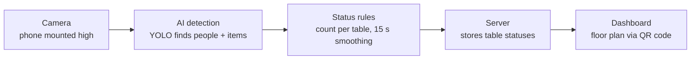

# TOPA

#Smart Table Finder

**AI-powered study space availability for our campus.**

Smart Table Finder shows students, in real time, which tables in a campus study area are **free**, **partly taken**, **full**, or holding **only someone's belongings**. A camera watches the area, a pre-trained AI model (YOLO) detects people and objects at each table, and a web dashboard shows the result on a colour-coded floor plan that anyone can open by scanning a QR code.

📄 **Full project report:** [docs/report.pdf](docs/report.pdf)

> **Team:** Martin Richiello, Guo Zhiqiang, Kaysun Molla, Husni Shahrour

---

## The problem

Students lose time every day looking for somewhere to sit and study. At peak times (between lectures, at lunch, and during exams), study areas fill quickly, and the only way to know whether a seat is free is to walk there and look.

- **Wasted time** walking between buildings looking for a table
- **Uneven use of space**: some areas are packed while others sit half-empty
- **Seat-saving**: bags and laptops left on tables for hours
- **No usage data** for the university to plan study spaces

The problem isn't a shortage of seats. It's a shortage of **information** about where the free seats are.

## Our solution



Each table is marked once as a region on the camera image, with its number of seats. Every few seconds, the system counts the people and items inside each region:

| Status | What the camera sees | Colour |
| --- | --- | --- |
| Free | No people and no belongings | 🟢 Green |
| Partly taken | Fewer people than seats | 🟡 Yellow |
| Full | As many people as seats | 🔴 Red |
| Items only | Belongings but no people (a timer starts) | ⚪ Grey |

A status only changes if it stays the same for about 15 seconds, so someone walking past doesn't make a table flicker.

## Why it works

- **Proven AI**: YOLO is already trained to recognise people, backpacks, laptops, books and cups, so no custom training is needed.
- **Low cost**: an ordinary smartphone works as the camera, and the dashboard is a web page with no app to install.
- **Simple, testable rules**: counting objects inside marked areas is easy to explain, test and adjust.
- **Scalable**: adding a study area means adding a camera and marking its tables once.

## Privacy

- Video is processed on the spot and **never stored or uploaded**
- **No face recognition**; the system only knows *that* someone is at a table, not *who*
- Only table statuses (for example, "Table 3: Full") leave the camera computer

## Repository structure

```
campus-table-finder/
├── README.md
├── requirements.txt
├── config/
│   └── tables.json        # table regions + seat counts
├── detector/
│   ├── detect.py          # runs YOLO on a video file or camera stream
│   ├── draw_tables.py     # tool to mark table regions on a frame
│   └── status_logic.py    # free / partly taken / full / items only
├── backend/
│   └── app.py             # API that stores and serves table statuses
├── frontend/
│   └── index.html         # live floor-plan dashboard
├── sample_videos/
└── docs/
    └── report.pdf         # full project report
```

## Getting started

```bash
# 1. Install dependencies
pip install -r requirements.txt

# 2. Mark the tables on a frame from your video
python detector/draw_tables.py --video sample_videos/demo.mp4

# 3. Start the backend
uvicorn backend.app:app --reload

# 4. Run detection (a video file, webcam index, or phone stream URL)
python detector/detect.py --source sample_videos/demo.mp4

# 5. Open the dashboard
#    http://localhost:8000
```

## Dashboard

The dashboard (`frontend/index.html`) shows the Learning Center laid out like the camera view: the three group rooms at the top, the 12 study tables in a 4 x 3 grid, and the 8 wall desks on the right. Each table is a card coloured by status (Empty, Semi-occupied, Occupied, Items only, No data), with a dot per seat, and summary counts at the top. It refreshes every 2 seconds from `GET /status`.

<!-- Screenshots: add files to docs/screenshots/ and uncomment


-->

Details, table IDs and how to test it: [frontend/README.md](frontend/README.md)

## Results

[Add your test results, for example: "On [N] minutes of test video, the system classified tables correctly [X]% of the time."]

## Future work

- Notifications when a table frees up
- Busy-hour predictions from past data
- More locations across campus
- Integration with the university app or student portal
